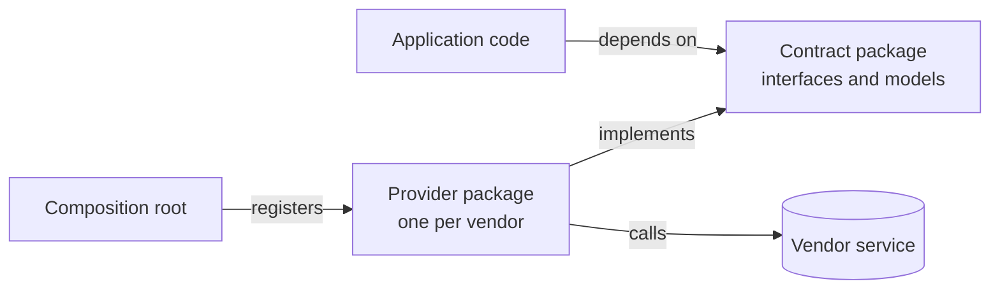
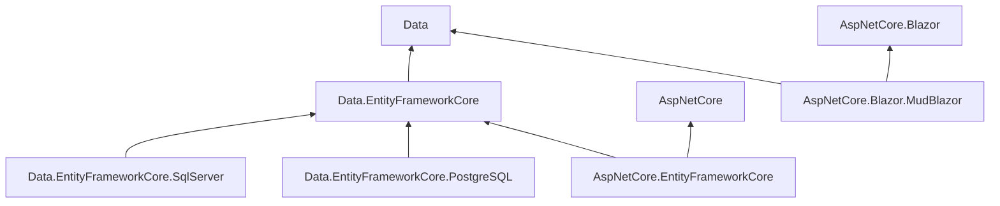
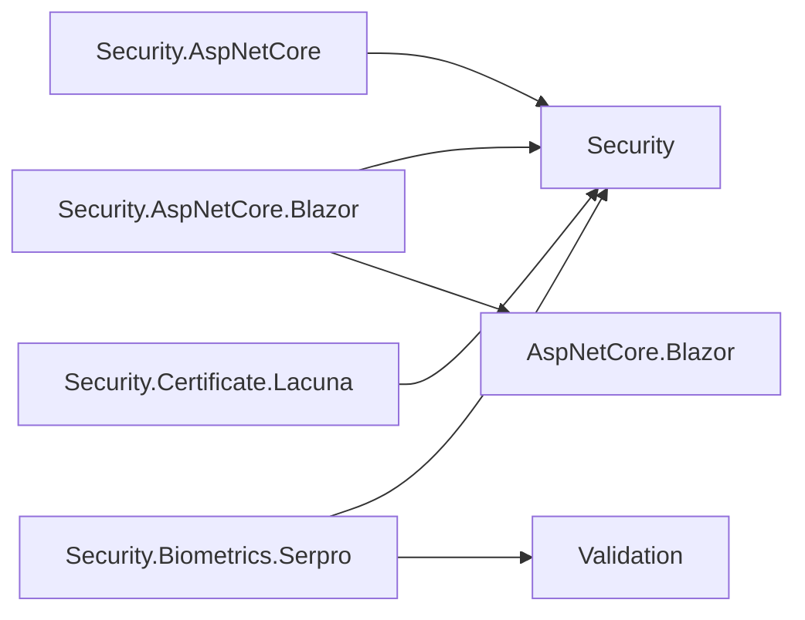
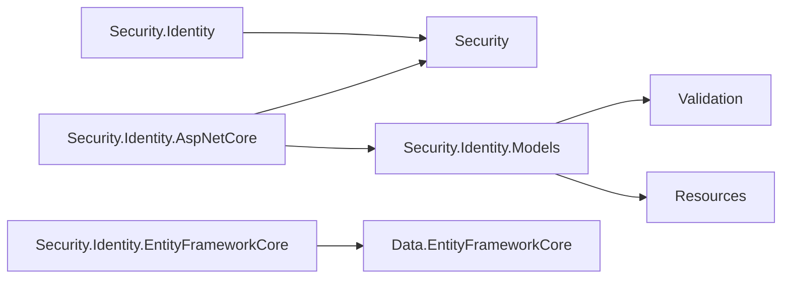
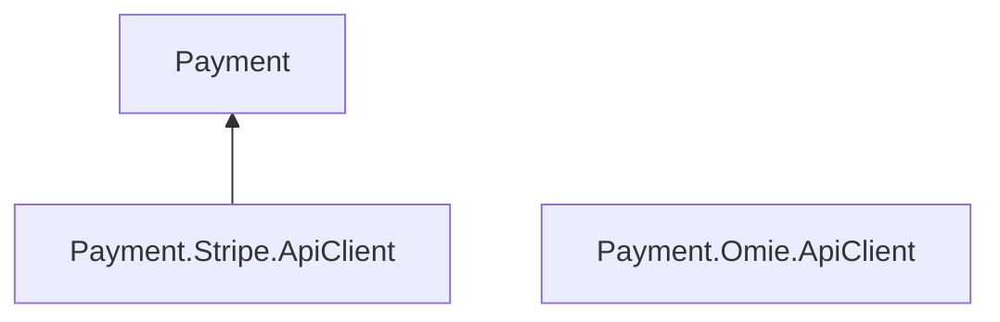
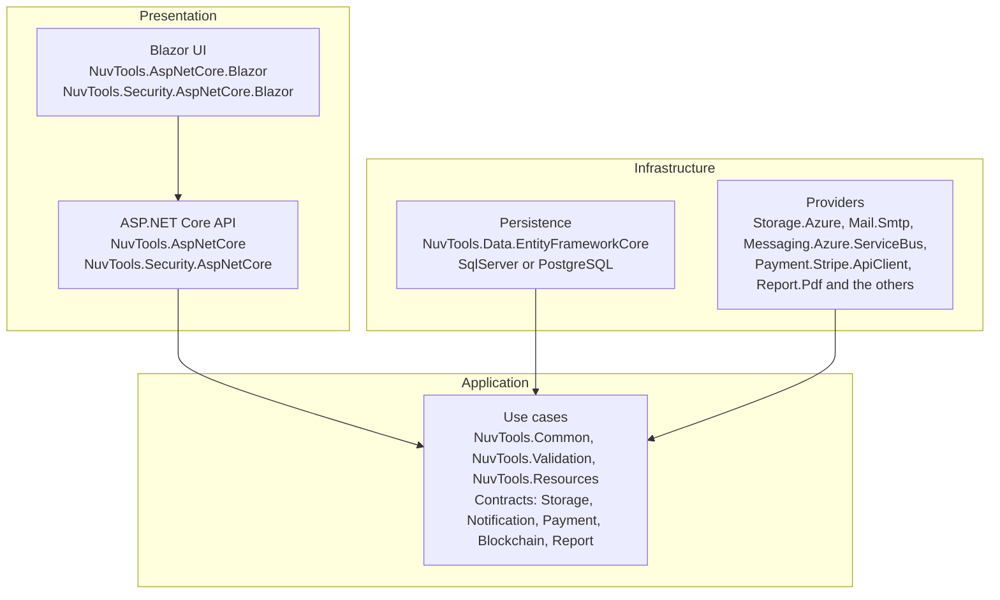

# Architecture

How the Nuv Tools packages are put together, and how they are meant to be referenced from an
application. The list of packages is in the [package catalog](https://github.com/nuvtools/.github/blob/main/profile/PACKAGES.md).

[Back to the overview](https://github.com/nuvtools)

## Contract and provider

Anything that talks to an outside service is split in two: a **contract** package that names the
operation and knows no vendor, and one **provider** package per vendor that implements it. The
vendor's SDK is referenced only by the provider.

Application code depends on the contract alone; the provider is chosen where the services are
registered. Changing vendor is then a change in one place, and the code that sends an e-mail or
stores a file does not move.

| Contract | Providers |
|---|---|
| `NuvTools.Storage` | `NuvTools.Storage.Azure` |
| `NuvTools.Notification.Mail` | `NuvTools.Notification.Mail.Smtp`, `NuvTools.Notification.Mail.Twilio` |
| `NuvTools.Notification.Messaging` | `NuvTools.Notification.Messaging.Azure.ServiceBus` |
| `NuvTools.Notification.Realtime` | `NuvTools.Notification.Realtime.Azure.SignalR` |
| `NuvTools.Blockchain` | `NuvTools.Blockchain.Azure` |
| `NuvTools.Payment` | `NuvTools.Payment.Stripe.ApiClient` |
| `NuvTools.Security` (facial verification) | `NuvTools.Security.Biometrics.Serpro` |
| `NuvTools.Security` (certificate authentication) | `NuvTools.Security.Certificate.Lacuna` |
| `NuvTools.Data.EntityFrameworkCore` | `NuvTools.Data.EntityFrameworkCore.SqlServer`, `NuvTools.Data.EntityFrameworkCore.PostgreSQL` |
| `NuvTools.Report` | `NuvTools.Report.Pdf`, `NuvTools.Report.Sheet`, `NuvTools.Report.FixedLength` |

## Dependencies between packages

One diagram per area, so each stays readable. An arrow means "references", and the
`NuvTools.` prefix is left off the names. Two things are not drawn:

- References to `NuvTools.Common`, listed at the end of this section: nearly everything has one and
  the arrows would bury the rest.
- The notification, storage, blockchain and report families, which reference no other Nuv Tools
  package and are referenced by none. Within each, the only references are from a provider to its
  contract.

### Data and Web

### Security

### Security.Identity

### Payment

`Payment.Omie.ApiClient` is a client for the Omie ERP and does not reference the `Payment`
contracts.

**Reference `NuvTools.Common`:** `NuvTools.Data.EntityFrameworkCore`,
`NuvTools.AspNetCore.Blazor.MudBlazor`, `NuvTools.Security.AspNetCore`,
`NuvTools.Security.AspNetCore.Blazor`, `NuvTools.Security.Biometrics.Serpro`,
`NuvTools.Security.Certificate.Lacuna`, `NuvTools.Security.Identity.AspNetCore`, `NuvTools.Payment`,
`NuvTools.Payment.Stripe.ApiClient`, `NuvTools.Payment.Omie.ApiClient` and, in its own repository,
`NuvTools.DataProvider.Client`, which references nothing else.

## Where each package belongs in an application

The packages are layered the way a typical layered or clean-architecture solution is, so each one
has an obvious home. A contract is referenced from the application layer; its provider is referenced
only where services are registered.

## Versioning and targets

- The current package versions are in the **10.x** line.
- Each package is versioned on its own; two packages from the same repository can carry different
  version numbers.
- The packages target **.NET 8, 9 and 10**, except `NuvTools.Payment.Stripe.ApiClient` and
  `NuvTools.Payment.Omie.ApiClient`, which target .NET 10 only.
