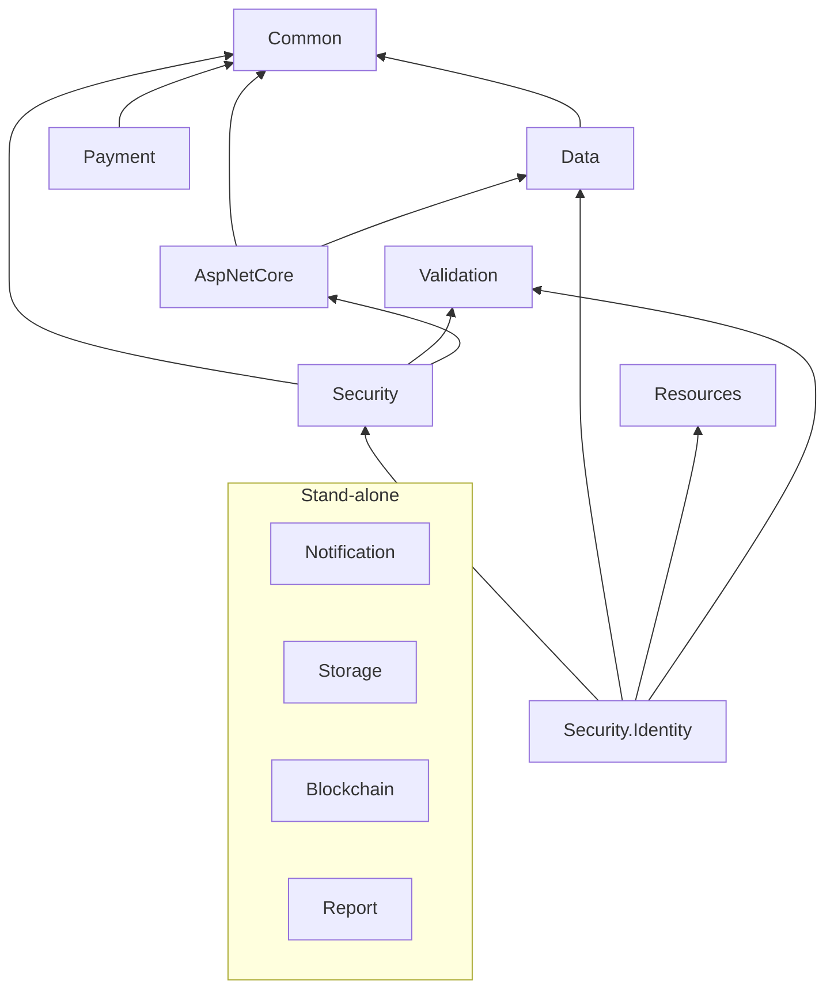
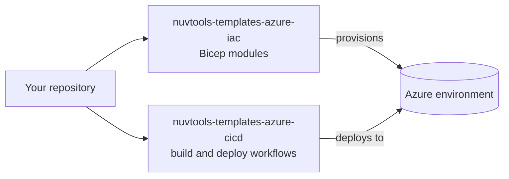

# Nuv Tools

Open-source building blocks for .NET applications: a family of small, focused NuGet packages for
data access, security, notifications, payments, reports and storage, plus the Azure templates used
to ship what is built with them.

[Website](https://nuvtools.com) · [Documentation](https://docs.nuvtools.com) · [NuGet](https://www.nuget.org/profiles/nuvtools) · [Contact](mailto:technology@nuvtools.com)

## What is here

| | |
|---|---|
| **[Nuv Tools Framework](#nuv-tools-framework)** | 39 NuGet packages in 12 repositories, for .NET 8, 9 and 10 |
| **[Azure templates](#azure-templates)** | Bicep modules and GitHub Actions workflows for provisioning and deploying on Azure |
| **[Data Provider SDK](#data-provider-sdk)** | The .NET client for APIs published on the Nuv Tools Data Provider marketplace |

The packages and the templates are MIT-licensed.

## Nuv Tools Framework

Each repository is one area and publishes its packages independently, so an application takes only
the ones it needs.

| Area | Repository | What it gives you |
|---|---|---|
| Foundation | [nuvtools-common](https://github.com/nuvtools/nuvtools-common) | Cross-platform utilities for Web, Desktop and Mobile (MAUI) |
| | [nuvtools-resources](https://github.com/nuvtools/nuvtools-resources) | English and Portuguese localization resources: actions, fields and message templates |
| | [nuvtools-validation](https://github.com/nuvtools/nuvtools-validation) | Validators and data annotations, including Brazilian documents (CPF, CNPJ, phone, CEP) |
| Data | [nuvtools-data](https://github.com/nuvtools/nuvtools-data) | Paging, sorting and filtering, and Entity Framework Core helpers for SQL Server and PostgreSQL |
| Web | [nuvtools-aspnetcore](https://github.com/nuvtools/nuvtools-aspnetcore) | ASP.NET Core, Blazor and MudBlazor helpers |
| Security | [nuvtools-security](https://github.com/nuvtools/nuvtools-security) | JWT, cryptography, CAPTCHA, and facial and certificate verification |
| | [nuvtools-security-identity](https://github.com/nuvtools/nuvtools-security-identity) | Permission-based authorization and user management on ASP.NET Identity |
| Integration | [nuvtools-notification](https://github.com/nuvtools/nuvtools-notification) | E-mail, messaging and real-time notifications |
| | [nuvtools-payment](https://github.com/nuvtools/nuvtools-payment) | Provider-neutral payment contracts, with Stripe and Omie clients |
| | [nuvtools-storage](https://github.com/nuvtools/nuvtools-storage) | File storage abstractions, with Azure Blob Storage |
| | [nuvtools-blockchain](https://github.com/nuvtools/nuvtools-blockchain) | Tamper-evident ledger abstractions, with Azure Confidential Ledger |
| Reporting | [nuvtools-report](https://github.com/nuvtools/nuvtools-report) | PDF, Excel and CSV reports, and fixed-length file reading |

The full list, one row per package with its NuGet link, is in the
**[package catalog](https://github.com/nuvtools/.github/blob/main/profile/PACKAGES.md)**.

### How the areas depend on each other

An arrow means "uses". The four areas in the box stand alone: they depend on no other Nuv Tools
package.



The package-level picture, and the contract-and-provider pattern the integration packages follow,
are in **[architecture](https://github.com/nuvtools/.github/blob/main/profile/ARCHITECTURE.md)**.

### Getting started

Install the packages you need from NuGet:

```bash
dotnet add package NuvTools.Common
dotnet add package NuvTools.Data.EntityFrameworkCore.SqlServer
```

Each repository's README covers its own packages, and the framework documentation is at
[docs.nuvtools.com](https://docs.nuvtools.com).

## Azure templates

| Repository | What it is |
|---|---|
| [nuvtools-templates-azure-iac](https://github.com/nuvtools/nuvtools-templates-azure-iac) | Modular Bicep templates for provisioning Azure infrastructure, with a configurable naming convention based on the Cloud Adoption Framework |
| [nuvtools-templates-azure-cicd](https://github.com/nuvtools/nuvtools-templates-azure-cicd) | Reusable GitHub Actions workflows and composite actions for deploying .NET applications to Azure (AKS and App Service) |

The two are meant to be used together: the Bicep modules create the environment, and the workflows
build the application and deploy into it.



## Data Provider SDK

[nuvtools-dataprovider-sdk](https://github.com/nuvtools/nuvtools-dataprovider-sdk) holds the .NET
libraries for the [Nuv Tools Data Provider](https://dataprovider.nuvtools.com) marketplace — what
somebody outside the platform installs to work with it. Today that is
[`NuvTools.DataProvider.Client`](https://www.nuget.org/packages/NuvTools.DataProvider.Client), the
consumer SDK for calling an API published there.

## Other repositories

| Repository | What it is |
|---|---|
| [nuvtools-docs](https://github.com/nuvtools/nuvtools-docs) | Source of [docs.nuvtools.com](https://docs.nuvtools.com) |
| [nuvtools-payment-for-java](https://github.com/nuvtools/nuvtools-payment-for-java) | Java payment abstraction library; last updated in 2023 |

## Contributing

Issues and pull requests are welcome in the repository of the package they concern. For anything
that does not fit one repository, write to [technology@nuvtools.com](mailto:technology@nuvtools.com).
